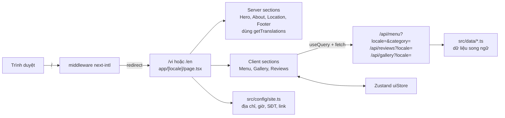

# Implementation Plan - Landing page "Một Ly Café & Matcha"

## Problem Statement

Quán chưa có website. Cần một landing page song ngữ vi/en để giới thiệu quán, menu lấy matcha làm chủ đạo, gallery, review, địa chỉ và kênh liên hệ. Quán chủ yếu bán mang đi và qua app giao đồ ăn, nên trang cần làm nổi bật nút gọi điện, chỉ đường và link đặt hàng qua app.

## Requirements

- Các section: Header (logo, menu điều hướng, nút đổi ngôn ngữ), Hero, Giới thiệu, Menu đầy đủ có lọc theo Matcha / Cà phê / Bánh, Gallery có lightbox, Review của khách, Địa chỉ và giờ mở cửa kèm bản đồ, Footer.
- Dữ liệu: mock API bằng Route Handlers của Next.js (`/api/menu`, `/api/reviews`, `/api/gallery`), gọi qua React Query + `fetch`.
- Ngôn ngữ: `next-intl`, đổi ngôn ngữ theo URL (`/vi`, `/en`). Mặc định là `vi`, vào `/` sẽ được chuyển sang `/vi`.
- Phong cách: Japanese minimal, tông xanh matcha và màu kem, nhiều khoảng trắng, animation nhẹ bằng Framer Motion.
- Thông tin quán (người dùng cung cấp, là bản tóm tắt do AI tạo nên cần người dùng kiểm tra lại):
  - Tên: Một Ly Café & Matcha. Quán nhỏ ở Gò Vấp, chủ yếu bán mang đi và qua app giao đồ ăn, có góc ngồi nhỏ ngoài trời trước quán.
  - Địa chỉ: 93 Trần Thị Nghỉ, Phường Hạnh Thông (Phường 1 cũ), Quận Gò Vấp, TP.HCM
  - Giờ mở cửa: 08:00 – 21:30, từ Thứ Hai tới Chủ Nhật
  - Điện thoại: +84 388 738 680
  - Facebook: https://www.facebook.com/p/M%E1%BB%98T-LY-61577808062423/
- Logo: tự vẽ một file SVG placeholder (không copy logo thật). Ảnh: placeholder trong `public/images/`, người dùng sẽ thay sau.
- Stack: Next.js 15 (App Router), TypeScript, pnpm, Tailwind, Radix UI, SCSS, Zustand, React Query, Framer Motion, Vitest + Testing Library, Playwright. Deploy lên Vercel.

## Background

- Hiện project chỉ có `README.md` (Tech: Next.js, Zustand, React Query, Tailwind, Radix, SCSS, thư viện animation, gọi API bằng fetch).
- `next-intl` hỗ trợ App Router với segment `[locale]`, middleware để chuyển hướng ngôn ngữ, và `getTranslations` cho Server Components. Nhờ đó tạo được metadata và thẻ `hreflang` riêng cho từng ngôn ngữ.
- Bản đồ dùng iframe Google Maps `https://maps.google.com/maps?q=<địa chỉ đã encode>&output=embed`, không cần API key. Nút "Chỉ đường" mở `https://www.google.com/maps/dir/?api=1&destination=<địa chỉ đã encode>`.
- SEO cho quán ở địa phương: thêm JSON-LD loại `CafeOrCoffeeShop` (địa chỉ, giờ mở cửa, SĐT, sameAs Facebook).
- Ảnh placeholder là file SVG (nền xanh matcha, ghi tên món). Mọi đường dẫn ảnh nằm trong file data/config, nên khi thay ảnh `.jpg` chỉ cần sửa ở một chỗ.
- Cách chia việc cho từng thư viện:
  - Radix: `Tabs` cho bộ lọc menu, `Dialog` cho lightbox gallery và menu trên mobile, `DropdownMenu` cho nút đổi ngôn ngữ.
  - Zustand: state giao diện dùng chung (danh mục menu đang chọn, ảnh đang mở trong lightbox, trạng thái menu mobile).
  - React Query: dữ liệu lấy từ server.
  - Tailwind: design tokens và layout.
  - SCSS: các phần trang trí khó viết bằng Tailwind (texture washi, đường cong ở hero).

## Proposed Solution



Cấu trúc thư mục:

```
PLAN.md
public/images/{logo.svg, hero/, about/, menu/, gallery/, og/, README.md}
messages/{vi.json, en.json}
src/
  app/[locale]/{layout.tsx, page.tsx, not-found.tsx}
  app/api/{menu,reviews,gallery}/route.ts
  app/{sitemap.ts, robots.ts}
  i18n/{routing.ts, request.ts, navigation.ts}
  middleware.ts
  config/site.ts
  data/{menu.ts, reviews.ts, gallery.ts}
  types/
  lib/{api.ts, query-client.ts}
  hooks/{useMenu.ts, useReviews.ts, useGallery.ts}
  store/ui-store.ts
  components/{layout,sections,ui}/
  styles/{globals.css, _tokens.scss, decor.module.scss}
tests/{unit, e2e}
```

## Task Breakdown

- [x] **Task 1: Khởi tạo project và tạo `PLAN.md`**
  - Mục tiêu: có một project Next.js chạy được, đủ công cụ, và lưu plan này trong repo.
  - Hướng dẫn:
    - Chạy `create-next-app` với TypeScript, App Router, Tailwind, ESLint, thư mục `src/`, dùng pnpm. Tạo trong thư mục hiện tại và giữ lại `README.md` cùng `PLAN.md`.
    - Cài `sass`, `framer-motion`, `zustand`, `@tanstack/react-query`, `next-intl`, `@radix-ui/react-tabs`, `@radix-ui/react-dialog`, `@radix-ui/react-dropdown-menu`, `clsx`.
    - Cài dev dependencies: `vitest`, `@vitejs/plugin-react`, `@testing-library/react`, `@testing-library/jest-dom`, `@testing-library/user-event`, `jsdom`, `@playwright/test`.
    - Thêm các script `dev`, `build`, `start`, `lint`, `test`, `test:e2e`.
    - Cập nhật `README.md`: sửa lỗi chính tả "Taildwind", thêm hướng dẫn chạy project.
  - Test: viết một smoke test Vitest để kiểm tra setup test chạy được.
  - Demo: `pnpm dev` mở được trang mặc định, `pnpm test` pass.

- [x] **Task 2: Design tokens, font, logo và ảnh placeholder**
  - Mục tiêu: chốt hệ thống màu, chữ và tài sản hình ảnh.
  - Hướng dẫn:
    - Định nghĩa màu trong Tailwind theme: `matcha-900/700/500/300/100`, `cream`, `ink`, `sakura` (màu nhấn nhẹ).
    - Font qua `next/font/google`: một font serif cho tiêu đề (Noto Serif hoặc Shippori Mincho, phải hỗ trợ dấu tiếng Việt, kiểm tra subset `vietnamese`) và Be Vietnam Pro cho nội dung.
    - Tạo `_tokens.scss` dùng chung biến với Tailwind.
    - Vẽ logo `public/images/logo.svg`: ly có lá matcha và chữ "Một Ly".
    - Tạo các ảnh SVG placeholder trong `public/images/{hero,about,menu,gallery,og}`.
    - Thêm `public/images/README.md` liệt kê tên file và kích thước khuyến nghị.
    - Tạo favicon/icon từ logo.
  - Test: không có test logic, kiểm tra bằng mắt.
  - Demo: trang tạm hiển thị logo, bảng màu và mẫu font.

- [x] **Task 3: i18n với `next-intl` và layout chung**
  - Mục tiêu: chạy được `/vi` và `/en`, vào `/` thì chuyển sang `/vi`.
  - Hướng dẫn:
    - Tạo `routing.ts` (locales `['vi','en']`, mặc định `vi`), `request.ts`, `navigation.ts` và `middleware.ts`. Middleware bỏ qua `/api`, `_next` và file tĩnh.
    - Viết `app/[locale]/layout.tsx`: đặt `<html lang>`, font, `NextIntlClientProvider`, `generateStaticParams`, `setRequestLocale`.
    - Viết `generateMetadata` theo từng ngôn ngữ, có `alternates.languages` cho thẻ hreflang.
    - Tạo `messages/vi.json` và `en.json` có key cho mọi section.
    - Tạo `src/config/site.ts` chứa tên, địa chỉ, giờ mở cửa, SĐT, link Facebook, link GrabFood/ShopeeFood (placeholder để trống), và tọa độ/URL bản đồ.
    - Làm Header có logo, anchor link tới các section, `LanguageSwitcher` bằng Radix DropdownMenu (giữ nguyên trang khi đổi ngôn ngữ), và menu mobile bằng Radix Dialog.
    - Làm Footer có thông tin liên hệ và mạng xã hội.
  - Test:
    - Unit test kiểm tra `vi.json` và `en.json` có cùng bộ key.
    - Unit test cho `LanguageSwitcher`.
    - E2E: vào `/` thì chuyển sang `/vi`; đổi ngôn ngữ thì URL thành `/en` và text đổi theo.
  - Demo: đổi qua lại vi/en trên Header và Footer.

- [x] **Task 4: Các section tĩnh (Hero, Giới thiệu, Địa chỉ)**
  - Mục tiêu: có trang đọc được, chưa cần dữ liệu từ API.
  - Hướng dẫn:
    - Hero: tiêu đề nhấn mạnh matcha, các nút CTA "Xem menu" (anchor `#menu`), "Gọi ngay" (`tel:+84388738680`) và "Đặt qua app", dùng `next/image` có `priority`.
    - Giới thiệu: câu chuyện quán, mang đi, góc ngồi ngoài trời.
    - Địa chỉ: địa chỉ, giờ mở cửa, iframe Google Maps (`loading="lazy"`, có `title`), nút "Chỉ đường".
    - Tất cả là Server Component dùng `getTranslations`. Hiệu ứng xuất hiện khi cuộn dùng wrapper client `<Reveal>` bằng Framer Motion, tôn trọng `prefers-reduced-motion` (`useReducedMotion`).
    - Phần trang trí ở hero viết bằng SCSS module.
  - Test:
    - Unit test cho `<Reveal>` khi bật reduced motion.
    - Unit test kiểm tra Location render đúng địa chỉ và link `tel:` / chỉ đường từ `site.ts`.
  - Demo: trang `/vi` có Hero, Giới thiệu và Địa chỉ, responsive, có animation nhẹ.

- [x] **Task 5: Mock API và data layer**
  - Mục tiêu: có các API trả dữ liệu song ngữ.
  - Hướng dẫn:
    - Định nghĩa types `MenuItem` (id, category `'matcha'|'coffee'|'bakery'`, name/description `{vi,en}`, price theo VND, image, tags như `signature`/`best-seller`), `Review` (author, rating 1–5, content `{vi,en}`, date), `GalleryImage` (src, alt `{vi,en}`, width, height).
    - Data mẫu (giá là placeholder, người dùng cần xác nhận):
      - Khoảng 6 món matcha: Matcha Latte, Matcha Kem Muối, Matcha Dừa, Matcha Dâu, Matcha Đá Xay, Matcha nguyên chất.
      - Khoảng 4 món cà phê: Cà phê sữa, Bạc xỉu, Americano, Cold Brew.
      - Khoảng 4 món bánh, ví dụ cookie matcha.
    - Route Handlers nhận `locale` và `category` (tùy chọn, có `all`), trả dữ liệu đã chọn đúng ngôn ngữ.
    - Kiểm tra input: `locale` hoặc `category` không hợp lệ thì trả 400. Đặt header `Cache-Control`.
  - Test: unit test từng handler (lọc đúng danh mục, đúng ngôn ngữ, trả 400 khi input sai).
  - Demo: `curl "localhost:3000/api/menu?locale=en&category=matcha"` trả JSON tiếng Anh.

- [x] **Task 6: React Query, Zustand và section Menu**
  - Mục tiêu: menu hoạt động đầy đủ với bộ lọc.
  - Hướng dẫn:
    - Tạo `query-client.ts` và `QueryProvider` (client component) đặt trong layout.
    - Tạo hàm `apiFetch<T>` trong `lib/api.ts`: dùng `fetch`, có xử lý lỗi và kiểu trả về.
    - Viết hook `useMenu(category)`, dùng query key có cả `locale` (lấy từ `useLocale`).
    - Tạo `store/ui-store.ts` với `activeCategory` (mặc định `matcha`), `lightboxIndex`, `mobileNavOpen` và các action. Chuyển menu mobile ở Task 3 sang dùng store này.
    - Section Menu (`id="menu"`) dùng Radix Tabs (Tất cả / Matcha / Cà phê / Bánh) và hiển thị lưới `MenuCard` có badge "Signature", giá định dạng VND bằng `Intl.NumberFormat`.
    - Có skeleton khi đang tải và trạng thái lỗi có nút thử lại.
    - Hiệu ứng chuyển khi lọc dùng `AnimatePresence`.
  - Test:
    - Unit test cho store.
    - Unit test cho `useMenu` (mock `fetch`).
    - Unit test Menu: bấm tab thì danh sách món đổi theo; hiển thị đúng skeleton và trạng thái lỗi.
    - E2E: lọc theo "Bánh".
  - Demo: lọc menu theo danh mục ở cả hai ngôn ngữ.

- [x] **Task 7: Gallery có lightbox và Review**
  - Mục tiêu: hoàn thiện các section còn lại.
  - Hướng dẫn:
    - Gallery: lưới kiểu masonry (CSS columns), bấm ảnh thì mở Radix Dialog. Lightbox chuyển ảnh bằng phím ←/→ và nút, trạng thái ảnh đang mở lưu trong `lightboxIndex` của store.
    - Reviews: carousel đơn giản bằng Framer Motion (kéo được, có nút trước/sau), hiển thị số sao có `aria-label`.
    - Cả hai lấy dữ liệu qua `useGallery` và `useReviews`.
    - Gắn hai section vào `page.tsx` theo thứ tự: Hero → Giới thiệu → Menu → Gallery → Review → Địa chỉ.
  - Test:
    - Unit test: lightbox mở và đóng được, phím mũi tên chuyển đúng ảnh.
    - Unit test: review render đúng số sao.
    - E2E: mở lightbox từ gallery.
  - Demo: trang có đủ mọi section.

- [x] **Task 8 (Lighthouse mobile Performance chưa đạt 90, xem Ghi chú triển khai): SEO, accessibility và hiệu năng**
  - Mục tiêu: trang sẵn sàng lên mạng.
  - Hướng dẫn:
    - Thêm JSON-LD `CafeOrCoffeeShop` lấy dữ liệu từ `site.ts` (address, openingHoursSpecification, telephone, sameAs).
    - Tạo `sitemap.ts` và `robots.ts` (có cả hai ngôn ngữ), ảnh Open Graph, `not-found.tsx` theo ngôn ngữ.
    - Thêm link "skip to content", kiểm tra focus ring, thêm `alt` song ngữ cho mọi ảnh.
    - Đảm bảo `sizes` của `next/image` hợp lý.
  - Test:
    - E2E kiểm tra JSON-LD và thẻ hreflang có trong HTML.
    - Chạy Lighthouse thủ công, mục tiêu ≥ 90 cho Performance, Accessibility và SEO.
  - Demo: `pnpm build && pnpm start`, chạy Lighthouse và xem điểm.

- [x] **Task 9: Hoàn thiện và chuẩn bị deploy**
  - Mục tiêu: kết thúc và bàn giao.
  - Hướng dẫn:
    - Đảm bảo lint, test và build đều pass.
    - Cập nhật `README.md`: cách thay ảnh, cách sửa `site.ts` và data menu, cách thêm bản dịch, cách deploy lên Vercel.
    - Tick các mục đã xong trong `PLAN.md`, thêm mục "Việc chủ quán cần làm": thay ảnh và logo thật, xác nhận menu và giá, thêm link GrabFood/ShopeeFood, kiểm tra lại địa chỉ và SĐT.
  - Test: chạy `pnpm lint && pnpm test && pnpm test:e2e && pnpm build`.
  - Demo: bản build production chạy local, sẵn sàng import vào Vercel.

## Giả định

- Menu và giá là dữ liệu giả.
- Link GrabFood/ShopeeFood để trống cho người dùng điền.
- Trang không có form liên hệ, khách liên hệ qua nút gọi điện và Facebook.

## Kết quả kiểm tra (04/11/2026)

- `pnpm lint`, `pnpm typecheck`: sạch.
- `pnpm test`: 39 unit test pass (messages, LanguageSwitcher, Reveal, Location, API routes, store, useMenu, Menu, Lightbox, Reviews/Stars).
- `pnpm test:e2e`: 8 test pass (redirect `/` → `/vi`, đổi ngôn ngữ, 404 đã dịch, lọc menu Bánh, lightbox, JSON-LD + hreflang + canonical, sitemap/robots, skip link).
- Lighthouse (build production, localhost):

  |                          | Performance | Accessibility | Best Practices | SEO |
  | ------------------------ | ----------- | ------------- | -------------- | --- |
  | Desktop                  | 98          | 100           | 100            | 100 |
  | Mobile (giả lập 4G chậm) | 77          | 100           | 100            | 100 |

## Ghi chú triển khai (khác với plan ban đầu)

- **Font tiêu đề:** dùng Noto Serif thay cho Noto Serif JP. Shippori Mincho không có dấu tiếng Việt; Noto Serif JP sinh ~130 KB CSS chặn render (mobile LCP chậm). Chữ trang trí "抹茶" dùng font hệ thống.
- **Prefetch phía server:** `page.tsx` prefetch menu (tab Matcha), gallery, review rồi truyền xuống React Query bằng `HydrationBoundary`, nên HTML có sẵn nội dung (tốt cho SEO, không nháy skeleton). Các tab menu khác gọi `/api/menu` bằng `fetch` trên client.
- **Framer Motion** dùng `LazyMotion` + `m` (tải tính năng sau), giảm First Load JS của trang từ 204 KB xuống 176 KB.
- **Đổi ngôn ngữ** không tự đoán theo trình duyệt (`localeDetection: false`): vào `/` luôn sang `/vi`.
- **Ảnh Open Graph** tạo tự động bằng `src/app/[locale]/opengraph-image.tsx` thay cho thư mục `public/images/og/`.
- **Lighthouse mobile 77:** LCP giả lập ~5s, phần lớn là "render delay" khi giả lập CPU chậm 4 lần, chạy trên server local chưa có CDN. Hướng cải thiện tiếp: deploy lên Vercel (CDN, HTTP/2) rồi đo lại bằng PageSpeed Insights; dùng ảnh hero thật dạng `.jpg/.webp` (Next.js tự chuyển AVIF và resize); nếu cần nữa thì bỏ hiệu ứng Reveal ở section đầu màn hình.
- **Mạng có proxy SSL:** build cần `NODE_OPTIONS=--use-system-ca` để tải Google Fonts (xem README).

## Việc chủ quán cần làm

- [ ] Thay logo thật (`public/images/logo.svg`) và favicon (`src/app/icon.svg`).
- [ ] Thay ảnh hero, giới thiệu, 14 ảnh món và 8 ảnh gallery (xem `public/images/README.md`).
- [ ] Xác nhận tên món, mô tả và **giá** trong `src/data/menu.ts` (hiện là dữ liệu mẫu).
- [ ] Thay **đánh giá mẫu** trong `src/data/reviews.ts` bằng đánh giá thật của khách (có sự đồng ý).
- [x] Mã cửa hàng GrabFood: `5-C733R4BJRCBCJE` (trong `src/config/site.ts` → `delivery.grabfood`).
- [ ] Nếu có link web của quán trên food.grab.com, dán vào `delivery.grabfood.webUrl` và đặt `webUrlIsStorePage: true`.
- [ ] Link ShopeeFood (nếu có) điền vào `delivery.shopeefood`.
- [ ] Kiểm tra lại địa chỉ, số điện thoại, giờ mở cửa trong `src/config/site.ts` (lấy từ bản tóm tắt do AI tạo).
- [ ] Đọc lại nội dung giới thiệu trong `messages/vi.json` và `messages/en.json` cho đúng giọng của quán.
- [ ] Khi có domain: đặt `NEXT_PUBLIC_SITE_URL` trên Vercel, gửi sitemap lên Google Search Console.

## Đợt 2: Redesign theo logo (04/11/2026)

- **Logo thật:** `public/images/logo.jpg` → `scripts/process-logo.mjs` tách nền tạo `logo.png`, `logo-light.png` (nét kem cho nền xanh), favicon `src/app/icon.png` + `apple-icon.png` (đầu gấu).
- **Màu:** bảng màu mới dựng quanh màu xanh trong logo `#3CAC54`: nền chính xanh đậm `#0D3D1F`, điểm nhấn xanh tươi `#6FCB5E`, hồng `#F6A8BB`. Token trong `globals.css` và `_tokens.scss`.
- **Font tiêu đề:** Baloo 2 (nét tròn, hợp logo vẽ tay, có dấu tiếng Việt), thay Noto Serif.
- **Design/animation mới** (đều tắt khi bật "giảm chuyển động"):
  - Hero nền xanh đậm: chữ hiện từng từ, nét gợn sóng tự vẽ, bọt matcha bay lên, khung ảnh "giọt matcha" biến hình, huy hiệu chữ xoay với mặt gấu, sticker nổi, sóng chạy ở đáy.
  - Hai dải chữ chạy ngược chiều (tên món).
  - Giới thiệu: logo dán như sticker, thẻ tính năng nghiêng kiểu sticker, phần "Ba bước, một ly matcha".
  - Menu: viên nền trượt theo tab, thẻ món nghiêng 3D theo con trỏ + ánh sáng lướt, món xuất hiện kiểu lò xo.
  - Gallery nền xanh đậm, ảnh kiểu polaroid nghiêng. Review dạng chồng thẻ kéo để lật.
  - Header trong suốt trên hero, thanh tiến trình cuộn. Footer có câu lớn "Một ly matcha nhé?".
- **Kiểm tra:** lint, typecheck, 39 unit test, 8 E2E pass. Lighthouse local: desktop 98 / 100 / 100, mobile Performance 91, Accessibility 100.

## Menu nổi bật (05/11/2026)
- Section mới "Menu nổi bật" giữa Giới thiệu và Menu: thẻ lớn cho món đang chọn (ảnh, tiêu đề quảng bá, câu chuyện, điểm nổi bật, giá, nút "Xem trong menu" / "Đặt ngay") và danh sách bên cạnh để chọn món.
- Dữ liệu mẫu: `src/data/featured.ts`, kiểu `FeaturedRecord` thiết kế sẵn như một collection CMS (menuItemId, headline, story, highlights, badge, image, theme, order, active, startsAt, endsAt).
- API `/api/featured?locale=`, hook `useFeatured`, prefetch phía server như các section khác. Không có mục nào đang chạy thì ẩn cả section.
- [ ] Khi có CMS: thay thân `getFeatured()` trong `src/lib/data-service.ts` bằng gọi CMS (nhớ giữ lọc active/thời gian nếu CMS không tự lọc).

## Tông màu (06/11/2026)
- Làm nhạt nền xanh đậm của tông mặc định: matcha-900 #0d3d1f → #1b552d, matcha-950 #082a14 → #123d20.
- 5 tông chủ đạo: matcha, uji, mint, hojicha, sakura. Chọn trong `src/config/site.ts` → `theme`; bộ chọn xem trước hiện khi `pnpm dev` hoặc `NEXT_PUBLIC_THEME_PREVIEW=1`.
- Màu nhấn phụ đổi tên token `sakura` → `accent` (mỗi tông có màu nhấn riêng). SCSS và bóng đổ dùng biến CSS nên đổi theo tông.
- Test `tests/unit/themes.test.ts` kiểm tra mỗi tông khai báo đủ biến màu.

## Nền sáng kiểu matcha latte (06/11/2026)
- Thêm token `surface` cho các mảng nền lớn (hero, gallery, đặt món, footer, header, menu mobile, thẻ nổi bật màu matcha): `--color-surface`, `surface-deep`, `on-surface`, `on-surface-soft`, `surface-accent`. Mỗi tông có bộ riêng trong globals.css / themes.css.
- Nền đổi từ xanh đậm sang xanh matcha nhạt (tông matcha: #bcd88f), chữ trên nền chuyển sang màu đậm. Logo dùng bản nét đen.
- Các chi tiết nhỏ (nút tab menu, nút lên đầu trang, avatar review…) vẫn giữ màu đậm để tạo điểm nhấn.
- Lighthouse mobile (local): Performance 95, Accessibility 100.

## Màu trend, bố cục và bảng menu tổng quan (06/11/2026)
- Tông mặc định đổi sang matcha dịu theo xu hướng 2026: xanh xô thơm/pistachio, kem sữa yến mạch và nâu mocha (cặp "matcha + Mocha Mousse"). Màu chính #74A662, nền mảng lớn #DCE9CF, nền trang #F8F5EC, nhấn #D6B48F.
- Bỏ viền đen 2px và bóng đổ cứng kiểu sticker, thay bằng bóng mềm (`shadow-soft`, `shadow-lift`) và viền mảnh.
- Bố cục mới: Hero → dải chữ → Món nổi bật → Menu → Giới thiệu → Hình ảnh → Đánh giá → Đặt món. Thanh điều hướng đổi thứ tự theo.
- Menu thành bảng tổng quan (menu board): mặc định tab "Tất cả", 3 cột Matcha / Cà phê / Bánh, mỗi món một dòng gọn (ảnh nhỏ, tên, giá dạng 45k, mô tả 1 dòng, nhãn). Bỏ thẻ món lớn `MenuCard`.

## Đổi 3 tông cuối sang matcha + bơ (06/11/2026)
- Bỏ `mint`, `hojicha`, `sakura`. Thêm `matcha-butter` (Matcha bơ sữa: matcha chủ đạo, nền vàng bơ), `avocado` (Xanh bơ: xanh vỏ quả bơ, nền màu ruột bơ), `butter` (Bơ & matcha: vàng bơ chủ đạo, nhấn matcha).
- Đã kiểm tra tương phản các cặp màu chính (nút, chữ phụ, chữ nhấn, giá, nhãn) đều ≥ 4.5:1.

## Nền hero mới (06/11/2026)
- `src/components/sections/HeroBackdrop.tsx`: nền nhiều lớp theo tông màu: mesh gradient trôi chậm, lưới chấm mờ dần, đĩa matcha lớn sau ly với vòng gợn sóng lan ra, chữ "MATCHA · MỘT LY" khổng lồ dạng viền trượt theo cuộn, parallax nhẹ theo chuột.
- Bỏ vầng sáng, bọt bay và chữ 抹茶 dọc cũ trong hero. Mọi chuyển động tắt khi bật "giảm chuyển động".
